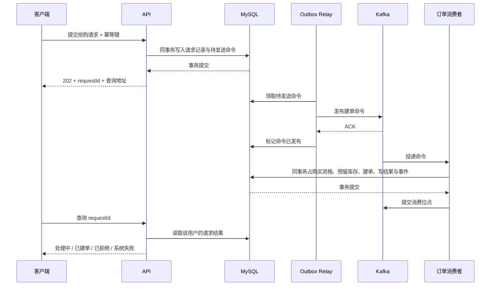
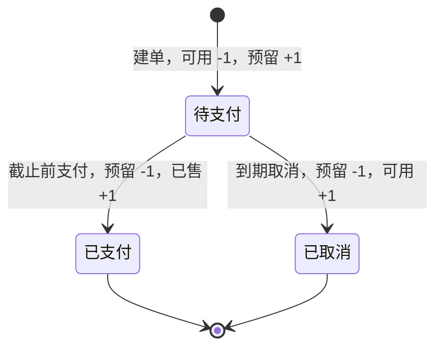
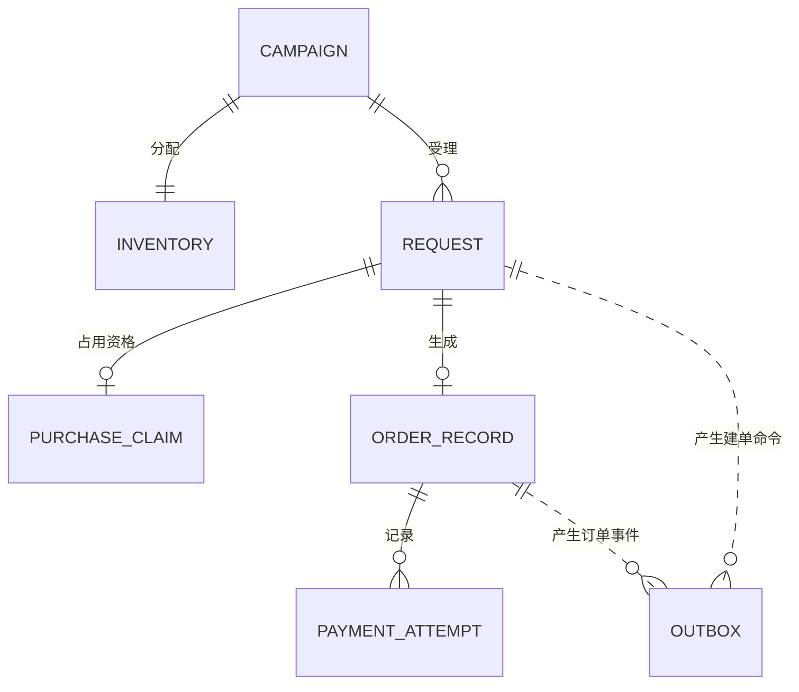

# FlashOrder V1 设计稿

> 状态：原稿，2026-11-19 存档，仅供对照。现行版本见 [../design-v1.md](../design-v1.md)，改动理由见 [../decisions.md](../decisions.md)。

**第一版做一条完整的限量抢购链路：提交请求 → 异步建单并预留库存 → 模拟支付或超时释放 → 查到最终结果。** 采用 Java 21、Spring Boot 3、MySQL、Kafka 和 Redis。API、订单消费者、定时任务来自同一个工程，可以按角色启动。MySQL 决定库存与订单状态，Kafka 缓冲建单流量，Redis 负责新请求限流。

延续你想从 GitHub 二开的思路，建议用 **`burst-safe-inventory`** 作底座，复用 Spring Boot 工程结构、并发测试和压测脚本。它原来用 PostgreSQL，迁移 MySQL 后要重新验证条件更新和事务行为。你自己的增量集中在**限时库存预留、支付与取消竞争、可靠异步受理**。 [底座仓库与并发实验](https://github.com/AkshajM16/burst-safe-inventory/tree/801b6953e4cb8bc822bfec77cf0d7c7ff782f804)

## 一、从抢购请求到订单

这里建议调整附件中的一个设计。**`202` 以 MySQL 受理事务提交为准。** 原稿的 Kafka 直投入口少一次数据库事务，但消费者落库前，用户拿着 `requestId` 可能查不到结果。第一版选择让受理后立即可查，并承担入口新增的短事务和 Outbox 发布开销。Kafka 停机时可在积压上限内继续受理，超过上限暂停新请求。这个取舍可以用接入延迟、受理到终态的延迟和积压恢复时间来验证。 [HTTP 202 语义](https://www.rfc-editor.org/rfc/rfc9110.html#section-15.3.3) · [Transactional Outbox](https://docs.aws.amazon.com/prescriptive-guidance/latest/cloud-design-patterns/transactional-outbox.html)

- **两种去重解决两个问题。** `(user_id, idempotency_key)` 去重同一次提交。同键同参数返回原 `requestId`，同键异参返回 `409`。`(campaign_id, user_id)` 限制一个用户同时占用的购买资格，换幂等键也不能多占一件。查询按登录用户校验归属。
- **命令可以重投。** Relay 收到 Kafka ACK 后标记已发布，消费者提交 MySQL 事务后再提交 offset。任一步在两次提交之间崩溃，都可能再次见到同一条消息。消费者锁定请求记录，发现已有终态就返回原结果。订单创建事件用同一套 Outbox 发布，保留稳定的 `event_id`。 [Kafka 消费位点](https://kafka.apache.org/39/javadoc/org/apache/kafka/clients/consumer/KafkaConsumer.html)
- **请求结果和订单状态各有含义。** `ORDER_CREATED` 记录这次请求曾成功建单。以后即使订单超时取消，请求结果仍可关联到原订单，最新状态从订单查询接口读取。

## 二、库存和订单怎么一起变化

每个活动独立分配库存，对应一个 SKU，每单一件。活动资格按服务端记录的受理时间判断，支付的 15 分钟从预留订单创建起算。**建议允许超时用户在活动仍开放时用新幂等键重试。** 所以已支付订单永久占用购买资格，超时取消在归还库存的同一事务中释放资格。

建单用 MySQL 条件更新，在 `available >= 1` 时同时减少可用库存、增加预留库存。模拟支付和超时任务锁定**同一条订单记录**，拿到锁后再取数据库时间判断。截止前允许支付，到达截止时间即可取消。状态、库存、购买资格在同一事务内变更。超期的模拟支付直接拒绝，第一版采用模拟支付命令，真实扣款和退款留到后续。 [InnoDB 锁定读取](https://dev.mysql.com/doc/refman/8.0/en/innodb-locking-reads.html) · [MySQL 时间函数](https://dev.mysql.com/doc/refman/8.0/en/date-and-time-functions.html)

库存验收同时看三条不变量。**库存数值非负，`总量 = 可用 + 预留 + 已售`，预留数与已售数分别等于待支付和已支付订单数。** 对账从同一数据库快照读取，发现差异先报告。

## 三、开发顺序和验收

| 里程碑 | 交付 | 过关条件 |
|---|---|---|
| **M1 · 同步基线** | 预置活动和测试用户，用 MySQL 完成同步建单、库存预留和两层幂等 | 200 个不同用户争 50 件库存，恰好 50 笔订单。重复键、同用户换键都不多占库存。扣库存后注入异常，事务完整回滚。 |
| **M2 · 订单闭环** | 模拟支付、超时回收、只读对账 | 重复支付、两个任务同时回收、付款等待锁直到过期，均只产生合法状态转换。库存与订单对得上。 |
| **M3 · 异步与恢复** | 同一个建单用例接入 Kafka，增加受理记录、Outbox 和 Redis 限流 | 验证提交后 HTTP 回包丢失、Relay 收到 ACK 后崩溃、消费者提交数据库后未提交 offset。恢复后原请求可查，同一请求最多一单。 |

最终用**同步与异步两组同负载实验**给简历提供证据。持续写入场景留足库存，测订单处理 TPS、端到端 P95/P99 和数据库锁等待。售罄洪峰单独测受理速率、限流和积压清空时间。这样面试时能讲清楚 Kafka 接住了多少突发请求、库存热点还卡在哪里，以及为什么故障重放没有重复扣库存。
