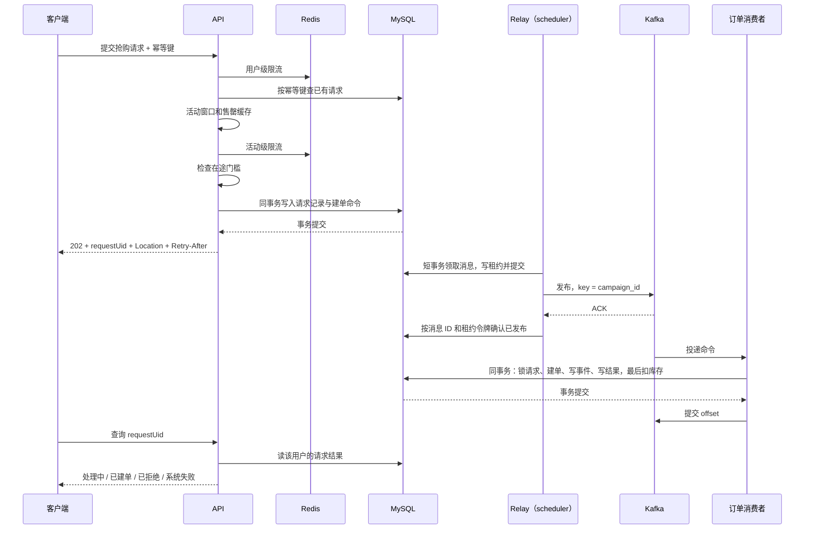
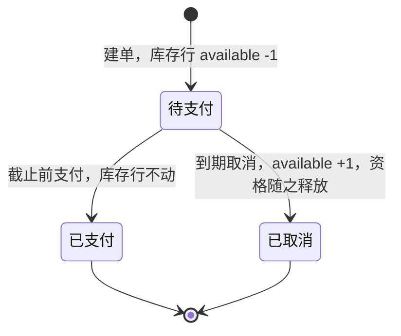
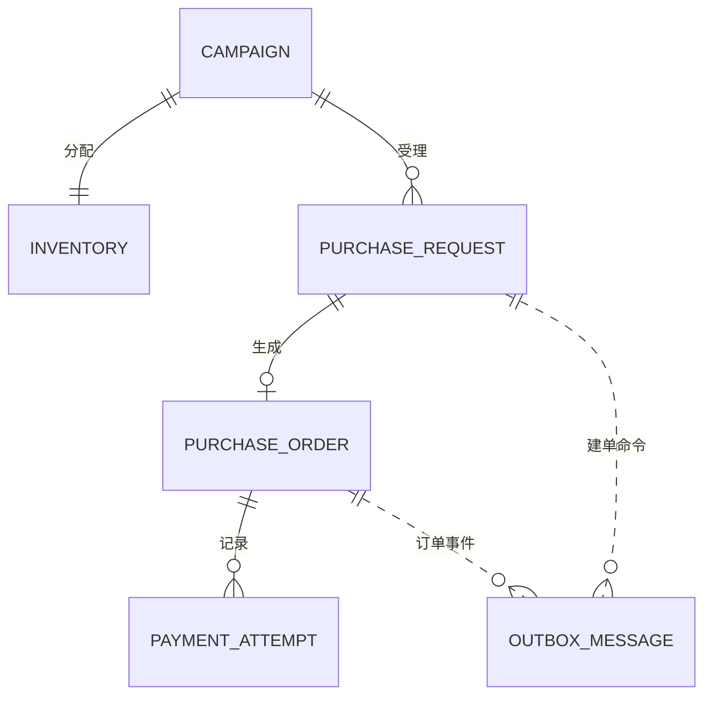

# FlashOrder V1 设计

> 状态：A–F 决策和 G1–G8 修订已合入设计。理由见 [decisions.md](decisions.md)。原稿存档在 [archive/design-v1-draft.md](archive/design-v1-draft.md)。

**第一版做一条完整的限量抢购链路：提交请求 → 异步建单并预留库存 → 模拟支付或超时释放 → 查到最终结果。**

- MySQL 决定库存、订单和请求状态，是唯一的事实来源。
- Kafka 让同一活动的建单命令依次落到库存行上。它缓冲的是**热点行竞争**，不是写入量：每个请求在受理时已经写过一次 MySQL。
- Redis 只做限流，库存判断全部在 MySQL 里。
- API、订单消费者、定时任务在同一个工程里，按 Spring profile 分角色启动。

## 零、技术栈与工程

| 项 | 选择 | 备注 |
|---|---|---|
| 语言 | Java 21 | |
| 框架 | Spring Boot 4.1.2（固定补丁版本） | 3.x 的开源支持已于 2026-06-30 结束；4.1.x 的开源支持到 2027-07-31 |
| 数据库 | MySQL 8.4 LTS，全局 `READ COMMITTED` | 理由见第二节 |
| 数据访问 | MyBatis Spring Boot Starter 4.1.0，Mapper 接口 + XML 手写 SQL | 以 Spring Boot 4.1 为基线 |
| 迁移 | Flyway | `dev` 的活动和库存由启动任务初始化，重复启动保留已扣减库存 |
| 消息 | Kafka，KRaft 单节点 | |
| 缓存 | Redis 7 | 只做限流 |
| 测试 | JUnit 5 + Testcontainers（MySQL、Kafka、Redis） | |
| 指标 | Micrometer + Prometheus，mysqld-exporter 采集 InnoDB 锁等待 | |
| 压测 | Python 标准库脚本，基于底座的 `stress/stress.py` 改造 | |
| 本地环境 | `docker compose` + Maven Wrapper | 不用 Makefile 和 bash，Windows 下直接能跑 |

**底座处理方式：新建工程，只借写法。** 从 `burst-safe-inventory`（MIT）借两样：并发集成测试的写法（Testcontainers 加统一放行门闩，跑完断言不变量），以及压测脚本 `stress/stress.py`。压测脚本直接复制，文件头保留原 MIT 声明，改成测"提交 → 轮询到终态"。README 注明参考来源。其余代码全部重写。

**包结构按业务域划分：**

```
com.flashorder
├─ request     受理、入口检查、请求查询
├─ order       建单用例、模拟支付、超时取消
├─ inventory   库存变更、对账、售罄缓存
├─ outbox      outbox 写入、Relay
└─ common      配置、Web、错误码、ID、指标
```

每个业务包有自己的 Mapper（接口 + XML），只放 SQL 和结果映射。事务边界放在应用服务层：`@Transactional` 标在服务方法上，一个用例对应一个事务，按业务流程顺着读就能看懂。

**MyBatis 一级缓存作用域设为 `STATEMENT`**，配置项为 `mybatis.configuration.local-cache-scope=statement`。默认的 `SESSION` 作用域下，同一事务里两次执行完全相同的查询，如果中间没有写操作，第二次会直接命中缓存，不发 SQL。`SELECT ... FOR UPDATE` 也是这样，相当于这一次没有加锁。本设计对请求行和订单行都有锁定读，所以全局关掉跨语句的缓存。

**启动角色（profile）：**

| profile | 内容 |
|---|---|
| `api` | HTTP 接口、入口检查、受理事务 |
| `consumer` | Kafka 监听、建单用例 |
| `scheduler` | 超时取消、Outbox Relay（两者都是定时轮询数据库的后台任务） |

本地 `dev` 组合启用 `api`、`scheduler` 和 `consumer`。单独运行 `scheduler` 或 `consumer` 时不开 HTTP。在 `async` 模式启动 Relay 和 Kafka 监听，压测时可将三个角色拆成独立进程。

**受理模式开关：** `flashorder.intake-mode=sync|async`。`sync` 是 M1 的同步基线，在 HTTP 线程里把受理和建单放进同一个事务。`async` 走 Kafka。两种模式调用同一个建单用例，方便做同负载对比。

## 一、从抢购请求到订单



### 1.1 `202` 以 MySQL 受理事务提交为准

受理事务提交后才返回 `202`。客户端用 `Location` 指向的 `/purchase-requests/{requestUid}` 查询请求状态，处理中响应附带 `Retry-After`。代价是入口多一个短事务和 Outbox 发布开销，可以用受理延迟、受理到终态延迟、积压清空时间来衡量。 [HTTP 202 语义](https://www.rfc-editor.org/rfc/rfc9110.html#section-15.3.3) · [Transactional Outbox](https://docs.aws.amazon.com/prescriptive-guidance/latest/cloud-design-patterns/transactional-outbox.html)

### 1.2 入口检查顺序

按顺序执行，便宜的检查放在前面：

M4 通过 `FLASHORDER_PROTECTION_ENABLED=true` 开启保护链路。同步与异步使用相同的限流和活动快照，异步额外检查在途门槛。关闭保护可复跑 M1–M3 基线。

1. 从请求头 `X-User-Id` 取当前用户（第一版模拟登录，真实认证留到后续）。
2. **用户级限流**，在 Redis 里做令牌桶，超限返回 `429 USER_RATE_LIMITED`。
3. **按 `(user_id, idempotency_key)` 查已有请求。** 找到时：活动相同，就按第三节的响应规则返回这个请求的当前状态，并带上 `Idempotent-Replayed: true` 头；活动不同，返回 `409 IDEMPOTENCY_CONFLICT`。这一步必须放在各种快速拒绝之前。否则用户回包丢失后重试，可能收到"售罄"，实际上原请求已经建单了。
4. **活动窗口预检**：拿本地缓存的活动起止时间做一次预检，不在窗口内返回 `409 CAMPAIGN_CLOSED`。最终以第 8 步受理事务里的数据库时间为准。
5. **售罄缓存**：缓存显示可用库存为 0 时，返回 `409 SOLD_OUT` + `Retry-After`，不写记录。
6. **活动级全局限流**，在 Redis 里做令牌桶，超限返回 `429 CAMPAIGN_RATE_LIMITED` + `Retry-After`。
7. **在途门槛**。异步请求的活动已有至少阈值数量的 `ACCEPTED`，则返回 `503 IN_FLIGHT_FULL` 和 `Retry-After`。
8. **受理事务**。异步模式插入请求记录（`ACCEPTED`，`accepted_at = NOW(6)`）和 Outbox 建单命令。用 `INSERT ... SELECT ... FROM campaign WHERE id = ? AND NOW(6) >= starts_at AND NOW(6) < ends_at` 带上窗口条件，影响零行时区分 `CAMPAIGN_CLOSED` 和 `CAMPAIGN_NOT_FOUND`。并发同键撞唯一键时读取原请求。

**售罄缓存**由每个 API 实例每 200 ms 从 MySQL 读取，使用非加锁读。刷新成功时，超时归还库存会在下一次刷新后反映到缓存。缓存年龄超过 600 ms 时跳过快速拒绝。窗口附近由受理事务按数据库时间裁决。

**限流降级**。正常时单键 Lua 使用 Redis 时间原子更新令牌桶。Redis 不可用时使用有界的进程内令牌桶，速率和容量都除以配置的 API 实例数。Redis 命令失败后默认冷却 1 秒，再由下一笔经过限流器的请求探测，同一进程同时只允许一次探测。切回 Redis 还需要 Lettuce 完成重连。默认重连退避间隔最长 30 秒，独立验收中 Redis 停机 45 秒后，从 Redis 恢复健康到限流切回用了 16.6 秒。Redis 和各进程分别记账，切换期间可能使用本地桶剩余的突发配额。 [M4 验收记录](reviews/2026-11-20-m4-acceptance.md)

**在途门槛**统计的是 `ACCEPTED` 数，Relay 和消费者停摆都能反映出来。每个实例默认每秒刷新一次，失败或过期时回到活动级索引查询。这是软门槛。Redis 正常时，一轮成功采样间隔内的新增量受活动桶的突发容量加补充速率乘实际间隔约束。采样延迟与 Redis 降级另行记录。

### 1.3 Kafka 与 Relay

- Topic `flashorder.order-commands`，**key 为 `campaign_id`**。同一活动的命令进同一个分区，由一个消费者线程依次处理，消费者之间不会在库存行上排队。代价是单个活动的吞吐受单线程限制。分区数不少于同时进行的活动数，本地默认 6 个。
- 生产者使用 `acks=all` 和幂等发送。默认 `max.block.ms=1000`、`delivery.timeout.ms=5000`。
- Relay 在短事务内用 `FOR UPDATE SKIP LOCKED` 领取未发布且租约为空或已过期的消息，写入 `lease_token`、`lease_until` 后提交。事务外发送。收到 Kafka ACK 后，按消息 ID 和租约令牌回写 `published_at`。默认每批 100 条，租约 30 秒。
- 生产者同步发送超时后停止向本批追加发送。生产者已报告失败或尚未尝试发送的记录按消息 ID 和租约令牌缩短到约 1 秒后可重领。发送结果未返回、发送 Future 被取消或进程中断时按原租约恢复。生产者报告失败时，消息也可能已经写入 broker，重投沿用原事件 ID，由消费者去重。
- 单轮中，满批全部标记发布后立即领取下一批。取到短批、有消息未能标记发布、或单轮已用时 1 秒时结束本轮。已领取的批次按租约处理结束，下一轮默认在本轮结束 250 ms 后启动。
- 消费者关闭自动提交，按条提交 offset（`AckMode.RECORD`）。先锁请求并核对命令里的请求和活动身份，数据库事务提交后再提交 offset。`spring.kafka.listener.concurrency` 默认 1，可用 `FLASHORDER_CONSUMER_CONCURRENCY` 调整。同一消费组内，每个分区仍交给一个监听线程。
- 消费者按分区内已发布命令的顺序处理。多个 Relay 并发领取或有消息重试时，后受理的命令可能先发布，订单事件也可能交错。**第一版只保证近似的先到先得。**
- 订单事件发到 `flashorder.order-events`，key 为订单号，事件带稳定的 `event_id`。第一版没有下游消费者。
- Relay 每天按批清理超过 7 天的已发布 Outbox 行。清理保留所有待发布行。

### 1.4 重投与失败

两次提交之间（Relay 收到 ACK 后标记已发布前、消费者提交数据库后提交 offset 前）发生崩溃，同一条命令会被再次投递。消费者第一步锁住请求行，发现已是终态就直接结束。

| 情况 | 处理 |
|---|---|
| 业务拒绝：售罄、已持有资格 | 回滚到保存点，在同一个事务里写 `REJECTED` 和原因，不重试（见 2.2） |
| 技术异常 | `DefaultErrorHandler` 在首次失败后指数退避重试 3 次。用尽后在一个恢复事务内锁住请求，把 `ACCEPTED` 转成 `SYSTEM_FAILED` 并写入死信 Outbox。提交结束后才允许确认原消息，死信由 Relay 发到 `flashorder.order-commands.DLT` |
| 命令格式或身份无效 | 用来源主题、分区及 offset 派生稳定事件 ID，记录死信并保留请求原状态 |
| 同一幂等键再次提交已失败的请求 | 返回 `409 REQUEST_FAILED`，带 `Idempotent-Replayed: true` 头，客户端换键重试 |

活动窗口只在受理时按 `accepted_at` 判断一次，消费者不再检查。所以活动结束前受理的请求，结束后才处理也照样有效。

### 1.5 请求结果与订单状态

请求状态有四种：`ACCEPTED`（处理中）、`ORDER_CREATED`、`REJECTED`（附带原因 `SOLD_OUT` 或 `ALREADY_HOLDING`）、`SYSTEM_FAILED`。`ORDER_CREATED` 只说明这次请求曾经成功建单。订单后来即使超时取消，请求结果仍然关联原订单，订单的最新状态从订单接口读取。

## 二、库存和订单怎么一起变化

每个活动对应一个 SKU，独立分配库存，每单一件。支付期限 15 分钟，从订单创建起算。超时取消的用户，可以在活动仍开放时换一个新幂等键重试。

**全局使用 `READ COMMITTED`**，由 MySQL 和 Hikari 配置。Connector/J 缓存 JDBC 会话状态，应用通过 JDBC API 修改事务隔离级别、只读状态和自动提交。使用该隔离级别的理由有两个：

- 撞唯一键等待结束后，下一条语句能读到对方已提交的结果。在 `REPEATABLE READ` 下，快照在事务的第一次读取时就已固定，后面读不到。
- 超时任务做范围扫描并加 `FOR UPDATE SKIP LOCKED` 时，不会加间隙锁挡住新订单插入。

唯一键冲突检查在 `READ COMMITTED` 下仍然会加锁，幂等不受影响。 [InnoDB 锁定读取](https://dev.mysql.com/doc/refman/8.0/en/innodb-locking-reads.html)



### 2.1 表结构



| 表 | 关键字段 | 约束与索引 |
|---|---|---|
| `campaign` | `id`、`sku`、`starts_at`、`ends_at` | |
| `inventory` | `campaign_id`（主键）、`total`、`available` | `CHECK (available BETWEEN 0 AND total)` |
| `purchase_request` | `id`、`request_uid`、`user_id`、`campaign_id`、`idempotency_key`、`status`、`reject_reason`、`order_id`、`accepted_at`、`finished_at` | `UNIQUE(user_id, idempotency_key)`、`UNIQUE(request_uid)`、`INDEX(campaign_id, status)` |
| `purchase_order` | `id`、`order_uid`、`request_id`、`campaign_id`、`user_id`、`status`、`created_at`、`expire_at`、`paid_at`、`cancelled_at`、`active_flag` | `UNIQUE(order_uid)`、`UNIQUE(request_id)`、`UNIQUE(campaign_id, user_id, active_flag)`、`INDEX(status, expire_at)`、`INDEX(campaign_id, status)` |
| `payment_attempt` | `id`、`order_id`、`idempotency_key`、`result`、`created_at` | `UNIQUE(order_id, idempotency_key)` |
| `outbox_message` | `id`、`event_id`、`topic`、`msg_key`、`event_type`、`payload`（JSON）、`created_at`、`published_at`、`lease_token`、`lease_until` | `UNIQUE(event_id)`、`INDEX(published_at, id)` |

- 主键都用自增 `BIGINT`。`request_uid`、`order_uid` 及常规 `event_id` 用 UUIDv7。死信事件 ID 由请求 ID 或来源位置确定性派生，重复恢复时仍使用原 ID。
- **库存行只存 `total` 和 `available`。** 预留数和已售数按订单状态统计，所以支付不碰热点行。
- **购买资格不单独建表。** `active_flag` 是生成列 `IF(status IN ('PENDING','PAID'), 1, NULL)`。MySQL 的唯一索引允许多个 NULL，所以一个用户在一个活动里最多只有一个待支付或已支付的订单。插入订单就是占资格，订单取消后资格自动释放。
- `UNIQUE(request_id)` 保证一个请求最多生成一个订单。订单查询和支付都按 `order_uid` 定位订单，所以 `order_uid` 也要建唯一索引 `UNIQUE(order_uid)`。
- **外键只指向 `campaign`，或者指向本事务已经锁住的行**，比如订单指向请求、支付记录指向订单。任何表都不引用 `inventory`。原因是 InnoDB 插入子表行时，会对父表的那一行加共享锁。如果订单表引用库存行，sync 模式下会这样死锁：两个线程各自插入订单，都拿到了库存行的共享锁；接着两边都要把它升级成排他锁去扣库存，于是互相等待。

### 2.2 建单（消费者，或 sync 模式下的 HTTP 线程）

**整个建单在一个事务里完成，业务拒绝也在这个事务里提交。** 热点行放到最后更新，这样它的锁持有时间最短：

1. 拿到请求行。async 模式下用 `SELECT ... FROM purchase_request WHERE id = ? FOR UPDATE` 锁住它；如果已是终态，说明是重投，直接结束。sync 模式下，它就是本事务在受理步骤里刚插入的那一行，通过 JDBC 生成键取得主键。同键的并发请求会卡在唯一键上，等本事务结束。
2. 设保存点 `before_order`。
3. 插入候选订单，状态 `PENDING`，`expire_at = NOW(6) + INTERVAL 15 MINUTE`。如果撞上 `(campaign_id, user_id, active_flag)` 唯一键，就回滚到保存点，把请求标成 `REJECTED(ALREADY_HOLDING)`，然后提交。
4. 插入 outbox 事件 `ORDER_CREATED`。
5. 用 JDBC 返回的订单主键，把请求标成 `ORDER_CREATED` 并关联 `order_id`。
6. 执行 `UPDATE inventory SET available = available - 1 WHERE campaign_id = ? AND available >= 1`。
7. 影响 1 行就提交。影响 0 行就回滚到保存点，撤销第 3–5 步写入的候选订单、事件和状态变更，再把请求标成 `REJECTED(SOLD_OUT)`，然后提交。

请求行和它的幂等键从头到尾都由本事务持有，同键请求插不进来。本事务提交后，同键请求才会撞键报错，然后按 1.2 第 3 步读出这条请求的终态返回。

**技术异常不走保存点，整个事务回滚。** sync 模式下请求行也一起撤销，客户端用同一个键重试即可。async 模式下请求仍是 `ACCEPTED`，等 Kafka 重新投递。

回滚到保存点时，MySQL 不会释放保存点之后拿到的行锁，但这里没有影响。在 `READ COMMITTED` 下，库存行的条件判断不成立时，锁在判断完就释放了；剩下的只有候选订单自己的索引项上的锁，提交时一起释放。实现上可以用 `TransactionStatus.createSavepoint()` 和 `rollbackToSavepoint()`，也可以把第 3–6 步放进另一个 Bean 的 `Propagation.NESTED` 方法里，Spring 的 JDBC 事务管理器两种都支持。 [MySQL 保存点](https://dev.mysql.com/doc/refman/8.4/en/savepoint.html)

### 2.3 模拟支付

`POST /orders/{orderUid}/payments` 使用与建单相同的 `X-User-Id`、`Idempotency-Key`。一次支付由一个事务完成。

1. `SELECT ... FROM purchase_order WHERE order_uid = ? AND user_id = ? FOR UPDATE`。
2. 如果已有同一 `(order_id, idempotency_key)` 的支付记录，返回原响应体和状态码，另带 `Idempotent-Replayed: true`。
3. 订单已是 `PAID` 就记录 `ALREADY_PAID` 并返回原支付时间。已是 `CANCELLED` 就记录 `REJECTED_CANCELLED`，返回 `409`。
4. 订单是 `PENDING` 时另发一条带 `NOW(6) < expire_at` 的条件更新。更新成功则改为 `PAID`，记录 `SUCCEEDED`，写入 `ORDER_PAID` 事件。更新零行则记录 `REJECTED_EXPIRED`，返回 `409`，由超时任务取消订单。

MySQL 在每条语句开始时取一次 `NOW(6)`。支付在拿到订单锁后才发条件更新，排队等锁跨过截止时间的请求会被拒绝。支付只更新订单、支付记录和 Outbox，`available` 保持原值。 [MySQL 时间函数](https://dev.mysql.com/doc/refman/8.4/en/date-and-time-functions.html)

### 2.4 超时取消（scheduler）

每批一个事务：

1. `SELECT id, campaign_id FROM purchase_order WHERE status = 'PENDING' AND expire_at <= NOW(6) ORDER BY expire_at, id LIMIT ? FOR UPDATE SKIP LOCKED`。
2. 批量改为 `CANCELLED`。`active_flag` 随之变成 NULL，资格同时释放。为每单写 `ORDER_CANCELLED` 事件。
3. 按 `campaign_id` 升序执行 `UPDATE inventory SET available = available + n`。顺序固定是为了避免死锁。
4. 提交。

`flashorder.order-expiry.batch-size` 默认 200，`flashorder.order-expiry.fixed-delay-ms` 默认 1000。一轮调度分批处理，每批独立提交后计入取消数量，直到一批取不到订单。

和支付竞争时，支付先拿到锁，这一批会跳过该订单。支付成功后，订单退出候选范围。取消先拿到锁时，支付等待提交，然后读到 `CANCELLED` 并拒绝。截止前允许支付，到达截止时间后允许取消。 [MySQL 锁定读取](https://dev.mysql.com/doc/refman/8.4/en/innodb-locking-reads.html)

### 2.5 不变量与对账

1. `0 ≤ available ≤ total`，由 CHECK 约束保证。
2. `total = available + 待支付订单数 + 已支付订单数`。
3. 一个用户在一个活动里最多一个活跃订单，由唯一索引保证。
4. 一个请求最多一个订单，由唯一索引保证。
5. `ORDER_CREATED` 状态的请求都有订单，`ACCEPTED` 和 `REJECTED` 状态的请求都没有订单。

库存对账使用以下 SQL。在 `READ COMMITTED` 下，一条语句使用同一个读视图，库存和订单数来自同一个快照。

```sql
SELECT i.total, i.available,
       (SELECT COUNT(*) FROM purchase_order o
         WHERE o.campaign_id = i.campaign_id AND o.status = 'PENDING') AS pending,
       (SELECT COUNT(*) FROM purchase_order o
         WHERE o.campaign_id = i.campaign_id AND o.status = 'PAID')    AS paid
  FROM inventory i
 WHERE i.campaign_id = ?;
```

`gap = total - available - pending - paid`。另一条查询用 `purchase_order.request_id` 核对请求与订单的对应关系，统计 `createdWithoutOrder` 与 `nonCreatedWithOrder`。两条查询分别取读视图，响应注明 `sameSnapshot: false`。三个差异值都为零时 `consistent` 为 `true`。对账只读并报告差异。

## 三、接口

| 接口 | 成功 | 其他结果 |
|---|---|---|
| `POST /campaigns/{campaignId}/purchase-requests`（头 `X-User-Id`、`Idempotency-Key`） | 按请求当前状态返回（见下表），首次提交和重放用同一套规则 | 入口拒绝不写记录。`404 CAMPAIGN_NOT_FOUND`。`409` `IDEMPOTENCY_CONFLICT` / `CAMPAIGN_CLOSED` / `SOLD_OUT`。`429` 用户或活动限流。`503` 数据库暂不可用或 `IN_FLIGHT_FULL` |
| `GET /purchase-requests/{requestUid}` | `200` + 状态、原因、`orderUid`；处理中时带 `Retry-After` | 不属于当前用户时返回 `404` |
| `GET /orders/{orderUid}` | `200` + 订单状态、UTC 时间 `expireAt` | `404` |
| `POST /orders/{orderUid}/payments`（头 `X-User-Id`、`Idempotency-Key`） | `200`，包含 `orderUid`、`status: PAID`、UTC `paidAt` | `409`，包含 `orderUid`、`status: REJECTED`、`reason: ORDER_EXPIRED` / `ORDER_CANCELLED`。订单不存在或属于他人时返回 `404` |
| `GET /admin/campaigns/{campaignId}/reconciliation` | `200`，包含库存差额、请求与订单差异和 `consistent` | 活动不存在时返回 `404` |

**提交接口的响应只由请求的当前状态决定**，首次提交和重放用同一套规则。只要请求写进了数据库，响应体就带 `requestUid`。入口快速拒绝返回 `NOT_ACCEPTED` 和原因。数据库锁冲突、锁等待超时或连接获取超时返回 `503 RETRYABLE` 和 `Retry-After`，客户端用原幂等键重试。

| 请求状态 | 响应 |
|---|---|
| `ACCEPTED` | `202` + `Location` + `Retry-After` |
| `ORDER_CREATED` | `201` + `orderUid` |
| `REJECTED` | `409` + 原因（`SOLD_OUT` / `ALREADY_HOLDING`） |
| `SYSTEM_FAILED` | `409 REQUEST_FAILED`，提示换键重试 |

重放的响应额外带 `Idempotent-Replayed: true`。async 模式下受理成功首次返回 `202`。sync 模式下受理成功首次返回建单终态。查询本人请求时返回 `200`，状态为 `ACCEPTED` 时附带 `Retry-After`。

## 四、指标

从 M1 开始接入，压测报告直接用这些数据：

- 受理延迟（HTTP 入口到 `202`），用直方图。
- 受理到终态延迟。消费者用锁定读返回的 MySQL 受理时长，加上单调时钟测得的执行和提交时间，在事务提交后记录直方图 `flashorder.requests.terminal.latency`。
- 在途请求数显示最近一次成功采样。未发布的 Outbox 行数显示最新采样，失败时输出 NaN。
- Kafka consumer lag。
- Hikari 连接池等待。
- InnoDB 行锁等待（`Innodb_row_lock_waits`、`Innodb_row_lock_time`，由 mysqld-exporter 采集）。
- 入口各类拒绝的计数：限流、售罄、在途已满、幂等冲突。
- M2 支付次数 `flashorder.payments`，按 `result` 和 `replayed` 统计。
- M2 已提交的超时取消订单数 `flashorder.orders.cancelled`。
- M2 最近一次对账的库存差额 `flashorder.reconciliation.gap`，按 `campaign` 标签区分活动。

## 五、开发顺序和验收

| 里程碑 | 交付 | 过关条件 |
|---|---|---|
| **M1 · 同步基线** | 工程骨架、compose、Flyway 表结构、预置活动和测试用户、`sync` 模式建单、两层去重、指标 | 200 个不同用户争 50 件库存，恰好 50 笔订单。同一用户换键也不能多占。同一个键 40 份并发：有库存时只有一条请求、一笔订单；**零库存时只有一条 `REJECTED(SOLD_OUT)` 请求，零笔订单，零条订单事件**。两种情况下，40 个响应的状态码、`requestUid` 和结果都相同，其中 39 个带 `Idempotent-Replayed: true`。在扣库存之后、提交之前注入异常，事务完整回滚，请求行也不留下。 |
| **M2 · 订单闭环** | 模拟支付、超时取消、对账接口 | 重复支付、两个超时任务同时跑、支付等锁一直等到过期，都只产生合法的状态转换。超时用户换键重试能再次建单。对账零差异。 |
| **M3 · 异步链路** | 受理事务、outbox、Relay、Kafka 消费者、请求查询 | 受理后立刻能查到。三类故障注入后，原请求可查，同一请求最多一单：提交后 HTTP 回包丢失、Relay 收到 ACK 后标记前崩溃、消费者提交数据库后提交 offset 前崩溃。毒消息最终变成 `SYSTEM_FAILED` 并进入死信主题。 |
| **M4 · 保护与实验** | 双层限流与降级、售罄缓存、在途上限、压测脚本改造、同步与异步对比实验 | 停掉 Kafka 后，在途上限以内继续受理，超过后返回 `503`；恢复后积压能清空，记录清空时间。停掉 Redis 后，限流降级为进程内令牌桶。两组实验都产出原始数据和报告。 |

**两组实验**（同一台机器，同步与异步用相同负载）：

- **持续写入**：库存留足，测订单处理 TPS、端到端 P95/P99、行锁等待。预期是异步模式的入口延迟更稳，但库存 TPS 不会更高，因为热点行的吞吐上限没有变。
- **售罄洪峰**：库存少、请求多，测受理速率、各类快速拒绝的占比、积压清空时间。

这两组数据用来在面试里讲清楚三件事：Kafka 接住了多少突发请求，热点还卡在哪里，故障重放为什么不会重复扣库存。笔记本上的数据只用于同机对比，不能当成容量结论。

## 六、第一版不做

真实支付和退款、多 SKU 订单、真实认证、库存分桶、读写分离、CDC（Debezium）、Kafka 事务，以及消费者微批扣减。微批是后续用来提升单活动库存 TPS 的首选方向。
