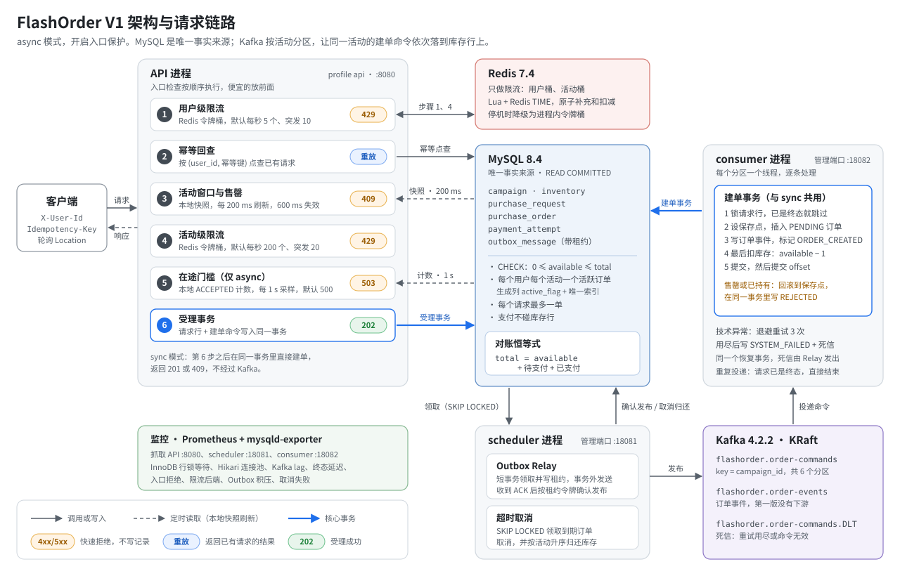
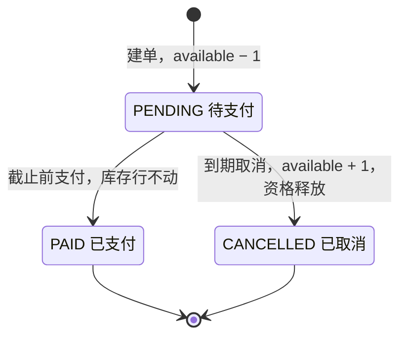

# FlashOrder 技术文档

> 本文描述 `main`（`aef5618`，2026-11-20）上已经实现的系统。产品范围见 [PRD](prd.md)，设计取舍和推导见 [design-v1.md](design-v1.md) 与 [decisions.md](decisions.md)。

## 1. 概览

FlashOrder 是限量抢购后端，核心链路是"提交请求 → 预留库存并建单 → 模拟支付或超时释放 → 查到最终结果"。整体设计有三条原则：

- **MySQL 是唯一的事实来源。** 库存、订单和请求状态都以它为准。
- **Kafka 缓冲热点行竞争，不缓冲写入量。** 同一活动的建单命令进同一个分区，依次落到库存行上。每个请求在受理时已经写过一次 MySQL。
- **Redis 只做限流。** 库存判断全部在 MySQL 里完成。



系统有两种受理模式，用 `flashorder.intake-mode` 切换：

- `sync`：HTTP 线程在一个事务里完成受理和建单，直接返回终态。
- `async`：受理事务写入请求和建单命令后返回 `202`，由 Relay 发到 Kafka，消费者再建单。

两种模式调用同一个建单用例（`PurchaseOrderProcessor`），所以能在相同负载下对比。

## 2. 技术栈

| 项 | 版本 / 选择 |
|---|---|
| 语言与框架 | Java 21，Spring Boot 4.1.2 |
| 数据访问 | MyBatis Spring Boot Starter 4.1.0，Mapper 接口 + XML 手写 SQL。一级缓存作用域为 `STATEMENT` |
| 数据库 | MySQL 8.4，全局 `READ COMMITTED`，时区 UTC，Flyway 迁移 |
| 消息 | Kafka 4.2.2，KRaft 单节点 |
| 限流 | Redis 7.4.12，Lettuce 客户端 |
| 监控 | Micrometer + Prometheus v3.13.5，mysqld-exporter v0.21.0 |
| 测试 | JUnit 5，Testcontainers（MySQL、Kafka、Redis），Awaitility |
| 压测 | `scripts/benchmark.py`，只用 Python 标准库 |
| 本地环境 | Docker Compose + Maven Wrapper，Windows PowerShell 下直接能跑 |

## 3. 部署与进程角色

同一个工程按 Spring profile 分角色启动：

| profile | 内容 | 端口 |
|---|---|---|
| `api` | HTTP 接口、入口保护、受理事务。sync 模式下还在 HTTP 线程里建单 | `8080`，同时提供 Actuator |
| `scheduler` | Outbox Relay、超时取消、Outbox 积压计数 | 单独运行时不开 HTTP。加上 `ops` 后开放管理端口 `18081` |
| `consumer` | Kafka 监听、建单、失败恢复 | 单独运行时不开 HTTP。加上 `ops` 后开放管理端口 `18082` |
| `dev` | `api` + `scheduler` + `consumer` 一体运行，并预置活动 `1` 和 50 件库存 | `8080` |

Compose 里的服务按 profile 启用，默认都只绑定 `127.0.0.1`：

| Compose profile | 服务 | 本机端口 |
|---|---|---|
| 默认 | MySQL 8.4（`READ-COMMITTED`，UTC） | `13306` |
| `async` | Kafka（6 个分区） | `19092` |
| `protection` | Redis（不持久化） | `16379` |
| `monitoring` | mysqld-exporter、Prometheus（每 2 s 抓取一次） | `19104`、`19090` |

## 4. 代码结构

```
com.flashorder
├─ request            受理、查询、建单用例和 Kafka 消费
│  ├─ PurchaseRequestController   提交和查询接口，按请求状态映射响应码
│  ├─ PurchaseRequestService      受理事务、幂等回查、sync 建单
│  ├─ PurchaseProtection          入口保护的检查顺序
│  ├─ PurchaseOrderProcessor      建单用例（sync 和 async 共用）
│  ├─ OrderCommandListener / OrderCommandProcessingService   消费命令、失败恢复、终态延迟指标
│  └─ guard/  PurchaseRateLimiter、LocalTokenBuckets、CampaignProtectionSnapshot
├─ order              订单查询、模拟支付、超时取消
├─ inventory          库存对账
├─ outbox             OutboxRelay（租约领取与发送）、调度器、清理和积压指标
└─ common             UUIDv7、Topic 定义、调度配置、数据库异常到 503 的映射、dev 预置数据
```

SQL 都在 `src/main/resources/mapper/*.xml` 里，迁移脚本在 `db/migration`：

- `V1`：建表；
- `V2`：给 Outbox 加租约列；
- `V3`：加 `(status, campaign_id)` 索引，供在途计数使用。

令牌桶脚本在 `redis/token-bucket.lua`。

## 5. 抢购请求链路

### 5.1 入口检查

开启 `flashorder.protection.enabled=true` 后，请求按下面的顺序检查，便宜的检查放在前面：

| 步骤 | 检查 | 依据 | 不通过时 |
|---|---|---|---|
| 1 | 用户级限流 | Redis 令牌桶 | `429 USER_RATE_LIMITED` |
| 2 | 幂等回查：按 `(user_id, idempotency_key)` 点查 | MySQL 唯一索引 | 已有请求时直接重放原结果，带 `Idempotent-Replayed: true` |
| 3 | 活动窗口和售罄 | API 本地快照 | `409 CAMPAIGN_CLOSED` 或 `409 SOLD_OUT` |
| 4 | 活动级限流 | Redis 令牌桶 | `429 CAMPAIGN_RATE_LIMITED` |
| 5 | 在途门槛（只在 async 模式检查） | API 本地 `ACCEPTED` 计数 | `503 IN_FLIGHT_FULL` |
| 6 | 受理事务 | MySQL | 见 5.2 |

几点说明：

- 第 2 步放在其余快速拒绝之前。原因是用户回包丢失后重试时，不能收到"售罄"或"限流"，而原请求其实已经建单。
- 第 3–5 步中任何一步要拒绝时，会再回查一次幂等键，防止同键的原请求恰好在这期间提交。
- 快速拒绝不写任何记录。`429`、`503` 和 `SOLD_OUT` 都带 `Retry-After: 1`。
- 不开启保护时，入口只做第 2 步和第 6 步，可以复跑 M1–M3 的基线。

### 5.2 受理事务

async 模式用一条 `INSERT ... SELECT ... FROM campaign WHERE id = ? AND NOW(6) >= starts_at AND NOW(6) < ends_at` 写入请求行（状态 `ACCEPTED`），活动窗口按数据库时间判断。插入零行时，再区分是 `CAMPAIGN_CLOSED` 还是 `CAMPAIGN_NOT_FOUND`。

建单命令写进同一个事务的 `outbox_message`。事务提交后才返回 `202`，带 `Location: /purchase-requests/{requestUid}` 和 `Retry-After`。同一个键并发提交时会撞唯一键，撞键的一方读出原请求返回。

### 5.3 建单事务

建单在一个事务里完成。业务拒绝也在这个事务里写入并提交。热点行放到最后更新，这样它的锁持有时间最短：

1. 锁请求行。async 模式用 `FOR UPDATE`，如果请求已是终态，说明是重投，直接结束。
2. 设保存点。
3. 插入 `PENDING` 订单，`expire_at = NOW(6) + 15 分钟`。如果撞上"每个用户每个活动一个活跃订单"的唯一键，就回滚到保存点，把请求标成 `REJECTED(ALREADY_HOLDING)`。
4. 写 `ORDER_CREATED` 事件到 Outbox，把请求标成 `ORDER_CREATED` 并关联订单。
5. 执行 `UPDATE inventory SET available = available - 1 WHERE campaign_id = ? AND available >= 1`。影响零行时回滚到保存点，把请求标成 `REJECTED(SOLD_OUT)`。
6. 提交。

技术异常不走保存点，整个事务回滚：

- sync 模式下请求行一起撤销，客户端用原幂等键重试即可。
- async 模式下请求仍是 `ACCEPTED`，等 Kafka 重新投递。

### 5.4 Outbox Relay 与 Kafka

- **领取。** Relay 在短事务里用 `FOR UPDATE SKIP LOCKED` 领取未发布、且租约为空或已过期的消息，写入 `lease_token` 和 `lease_until` 后提交。默认每批 100 条，租约 30 s。
- **发送与确认。** 发送在事务外进行，key 为 `campaign_id`。收到 ACK 后，按"消息 ID + 租约令牌"回写 `published_at`。
- **失败重领。** 生产者报告失败的消息，以及本批还没来得及发送的消息，租约缩短到约 1 s 后可以重新领取。发送结果未知时，按原租约恢复。
- **续领。** 满批全部确认后立即领取下一批。本轮在三种情况下结束：取到短批、有消息没确认、本轮累计满 1 s。下一轮在 250 ms 后开始。
- **清理。** 每天 03:00 清理超过 7 天的已发布行。
- **生产者参数。** `acks=all`，开启幂等发送；`max.block.ms=1000`，`delivery.timeout.ms=5000`。
- **Topic。** `flashorder.order-commands`、`flashorder.order-events` 和 `flashorder.order-commands.DLT`，各 6 个分区。

### 5.5 消费者与失败恢复

- **按条提交 offset。** 关闭自动提交，用 `AckMode.RECORD`。数据库事务提交后才提交 offset。
- **并发。** 默认 1 个监听线程，可以用 `FLASHORDER_CONSUMER_CONCURRENCY` 调整。同一分区始终只由一个线程处理，所以单个活动的命令是串行处理的。
- **技术异常重试。** 首次失败后按 100 ms 起、乘 2、最长 1 s 退避，重试 3 次。用尽后在一个恢复事务里完成三件事：锁住请求，把 `ACCEPTED` 改成 `SYSTEM_FAILED`，写一条死信 Outbox。死信由 Relay 发到 DLT。
- **毒消息。** 命令格式或身份无效时不重试，直接记录死信，请求保持原状态。
- **重复投递。** 两种崩溃会让同一条命令再次投递：Relay 收到 ACK 后、标记发布前崩溃；消费者提交数据库后、提交 offset 前崩溃。消费者第一步会锁请求行，发现已是终态就直接结束，所以不会重复扣库存。

## 6. 订单生命周期



**模拟支付**（`POST /orders/{orderUid}/payments`）在一个事务里完成：

1. 用 `FOR UPDATE` 锁住当前用户的订单。
2. 同一支付键已有记录时，重放原响应。
3. 订单已支付时，返回原支付时间。订单已取消时，返回 `409`。
4. 订单待支付时，执行带 `NOW(6) < expire_at` 条件的更新。成功则写支付记录和 `ORDER_PAID` 事件。更新零行则返回 `409 ORDER_EXPIRED`。

支付只改订单、支付记录和 Outbox，不碰库存行。

**超时取消**由 scheduler 执行，每批一个事务：

1. 用 `FOR UPDATE SKIP LOCKED` 领取到期的 `PENDING` 订单，每批最多 200 条。
2. 改成 `CANCELLED`，写 `ORDER_CANCELLED` 事件。
3. 按 `campaign_id` 升序归还库存。顺序固定是为了避免死锁。
4. 提交。

一轮调度连续处理多批，直到取不到订单为止，下一轮在 1 s 后开始。如果归还库存时违反约束，这一批整体回滚，失败计数加一。

和支付竞争时，谁先拿到订单锁，就由谁决定结果：

- 支付先拿到锁：取消任务跳过这一单。
- 取消先拿到锁：支付读到 `CANCELLED`，拒绝支付。

## 7. 数据模型

| 表 | 作用 | 关键约束 |
|---|---|---|
| `campaign` | 活动和起止时间 | `CHECK (starts_at < ends_at)` |
| `inventory` | 每个活动一行，只存 `total` 和 `available` | `CHECK (available BETWEEN 0 AND total)` |
| `purchase_request` | 抢购请求和结果 | `UNIQUE(user_id, idempotency_key)`、`UNIQUE(request_uid)`、`INDEX(campaign_id, status)`、`INDEX(status, campaign_id)` |
| `purchase_order` | 订单 | `UNIQUE(order_uid)`、`UNIQUE(request_id)`、`UNIQUE(campaign_id, user_id, active_flag)`、`INDEX(status, expire_at)`、`INDEX(campaign_id, status)` |
| `payment_attempt` | 支付记录 | `UNIQUE(order_id, idempotency_key)` |
| `outbox_message` | 建单命令、订单事件、死信 | `UNIQUE(event_id)`、`INDEX(published_at, id)`。租约列 `lease_token`、`lease_until` 必须同时为空或同时有值 |

几个关键设计：

- **购买资格不单独建表。** `active_flag` 是生成列 `IF(status IN ('PENDING','PAID'), 1, NULL)`，加上唯一索引后，一个用户在一个活动里最多一个活跃订单。订单取消后资格自动释放。
- **库存行只存两个数。** 预留数和已售数按订单状态统计，所以支付不碰热点行。
- **任何表都不引用 `inventory`。** 外键只指向 `campaign`，或者指向本事务已经锁住的行。这样可以避免插入订单时对库存行加共享锁，引发死锁。
- **ID。** 主键是自增 `BIGINT`。`request_uid`、`order_uid` 和常规 `event_id` 用 UUIDv7，死信事件 ID 按来源确定性派生。

**不变量与对账。** 对账接口检查两件事：

- 库存恒等式 `total = available + PENDING 数 + PAID 数`。
- 请求与订单的对应关系，统计 `createdWithoutOrder` 和 `nonCreatedWithOrder` 两个差异数。

三个差异都为零时，`consistent` 为 `true`。两条查询各取一个读视图，响应里注明 `sameSnapshot: false`。

## 8. 入口保护

### 8.1 令牌桶

- **Redis 桶。** 单键 Lua 脚本用 Redis 的 `TIME` 原子地补充和扣减令牌。key 是 `flashorder:rate-limit:{user|campaign}:{id}`，存 `tokens` 和 `updated_at` 两个字段。
  - Redis 时钟回退时不补充令牌。
  - 过期时间按"补满所需时间 + 时钟偏差"设置。
- **默认配额。**
  - 用户：每秒 5 个，突发 10。
  - 活动：每秒 200 个，突发 20。
- **降级。** Redis 命令超时（100 ms）或失败时，改用进程内令牌桶，速率和容量都除以 `rate-limit.instances`。之后冷却 1 s，再让下一笔请求探测 Redis，同一时间只有一笔探测。
  - 本地桶最多 10,000 个 key。超过后，新 key 一律拒绝。
  - 切回 Redis 要等 Lettuce 重连成功，默认退避最长 30 s。这段时间按本地配额限流，不会放松。

### 8.2 活动快照（窗口与售罄）

- 每个 API 实例每 200 ms 用非加锁读读取活动窗口和可用库存。
- 窗口判断用数据库时间加单调时钟推算，窗口边界前后各留一个刷新周期的余量。余量内的请求交给受理事务按数据库时间裁决。
- 快照超过 600 ms 没有刷新成功，就不再用它做快速拒绝，请求照常往后走。
- 超时取消归还库存后，下一次刷新成功时，快照就能看到新库存。

### 8.3 在途门槛

- **计数。** async 模式下，每个 API 实例每 1 s 批量统计各活动的 `ACCEPTED` 数，默认门槛 500。
  - 采样超过 3 s 或刷新失败时，改为逐请求用 `(status, campaign_id)` 索引计数。
  - 统计 `ACCEPTED` 而不是统计未发布的 Outbox 行，是因为前者在 Relay 停摆和消费者停摆时都会上涨。
- **这是软门槛。** Redis 正常时，一个采样间隔内最多超放"活动桶突发容量 + 补充速率 × 实际采样间隔"。独立验收在默认配置下测得：超放 193 笔，上界约 220。

## 9. 接口与响应码

| 接口 | 成功 | 其他结果 |
|---|---|---|
| `POST /campaigns/{campaignId}/purchase-requests` | 按请求当前状态返回，见下表 | 入口拒绝返回 `NOT_ACCEPTED` 和原因，不写记录：<br>• `404 CAMPAIGN_NOT_FOUND`；<br>• `409`：`IDEMPOTENCY_CONFLICT` / `CAMPAIGN_CLOSED` / `SOLD_OUT`；<br>• `429`：用户或活动限流；<br>• `503`：`IN_FLIGHT_FULL`，或数据库暂时不可用 |
| `GET /purchase-requests/{requestUid}` | `200`，带状态、原因和 `orderUid`。处理中时带 `Retry-After` | 不是本人的请求返回 `404` |
| `GET /orders/{orderUid}` | `200`，带订单状态和 UTC 格式的 `expireAt` | `404` |
| `POST /orders/{orderUid}/payments` | `200 PAID`，带 UTC 格式的 `paidAt` | `409 REJECTED`，原因为 `ORDER_EXPIRED` 或 `ORDER_CANCELLED`。订单不存在或不属于本人时返回 `404` |
| `GET /admin/campaigns/{campaignId}/reconciliation` | `200`，带库存差额、请求与订单差异和 `consistent` | `404` |

提交接口的响应只由请求的当前状态决定，首次提交和重放用同一套规则：

| 请求状态 | 响应 |
|---|---|
| `ACCEPTED` | `202` + `Location` + `Retry-After` |
| `ORDER_CREATED` | `201` + `orderUid` |
| `REJECTED` | `409`，原因为 `SOLD_OUT` 或 `ALREADY_HOLDING` |
| `SYSTEM_FAILED` | `409 REQUEST_FAILED`，提示换键重试 |

重放的响应额外带 `Idempotent-Replayed: true`。锁冲突、锁等待超时和连接池超时统一返回 `503`，带 `Retry-After: 1`，客户端用原幂等键重试。

## 10. 配置项

| 配置 | 默认值 | 说明 |
|---|---|---|
| `flashorder.intake-mode`（`FLASHORDER_INTAKE_MODE`） | `sync` | `sync` 或 `async` |
| `flashorder.protection.enabled`（`FLASHORDER_PROTECTION_ENABLED`） | `false` | 是否开启入口保护 |
| `flashorder.protection.rate-limit.user-rate-per-second` / `user-burst` | 5 / 10 | 用户令牌桶 |
| `flashorder.protection.rate-limit.campaign-rate-per-second` / `campaign-burst` | 200 / 20 | 活动令牌桶 |
| `flashorder.protection.rate-limit.instances` | 1 | Redis 降级时，本地配额按这个实例数分摊 |
| `flashorder.protection.rate-limit.redis-retry-ms` | 1000 | Redis 失败后的探测冷却时间 |
| `flashorder.protection.rate-limit.max-local-buckets` | 10000 | 本地桶的 key 上限 |
| `flashorder.protection.campaign-refresh-ms` / `campaign-max-age-ms` | 200 / 600 | 活动快照的刷新间隔和失效时间 |
| `flashorder.protection.backlog-limit` | 500 | 在途门槛 |
| `flashorder.protection.backlog-refresh-ms` / `backlog-max-age-ms` | 1000 / 3000 | 在途计数的刷新间隔和失效时间 |
| `flashorder.outbox-relay.batch-size` / `lease-ms` | 100 / 30000 | Relay 批大小和租约 |
| `flashorder.outbox-relay.retry-delay-ms` | 1000 | 发送失败后多久可以重领 |
| `flashorder.outbox-relay.max-round-ms` / `fixed-delay-ms` | 1000 / 250 | 单轮时限和轮间隔 |
| `flashorder.outbox-relay.retention-days` / `cleanup-cron` | 7 / `0 0 3 * * *` | 已发布行的保留天数和清理时间 |
| `flashorder.order-expiry.batch-size` / `fixed-delay-ms` | 200 / 1000 | 超时取消的批大小和轮间隔 |
| `FLASHORDER_CONSUMER_CONCURRENCY` | 1 | 消费者监听线程数 |
| `FLASHORDER_DB_POOL_SIZE` | 10 | Hikari 连接池上限 |
| `spring.data.redis.timeout` / `connect-timeout` | 100 ms | Redis 命令超时和连接超时 |
| `spring.task.scheduling.pool.size` | 2 | 调度线程数 |

连接地址可以用环境变量覆盖：`FLASHORDER_DB_URL`、`FLASHORDER_KAFKA_BOOTSTRAP`、`FLASHORDER_REDIS_HOST` 和 `FLASHORDER_REDIS_PORT`。

## 11. 可观测性

Actuator 开放 `/actuator/health` 和 `/actuator/prometheus` 两个端点。自定义指标如下：

| 指标 | 含义 |
|---|---|
| `flashorder.purchase.submissions` | 提交结果计数，按 `status`、`reason`、`replayed` 分类 |
| `flashorder.requests.terminal.latency` | 从受理到终态的延迟直方图，事务提交后记录 |
| `flashorder.requests.accepted` | 各活动最近一次采样到的 `ACCEPTED` 数 |
| `flashorder.rate.limit.decisions` | 限流决定计数，按 `scope`、`backend`（redis 或 local）、`result` 分类 |
| `flashorder.rate.limit.redis.failures` | Redis 限流失败次数 |
| `flashorder.outbox.unpublished` | 未发布的 Outbox 行数，采样失败时为 NaN |
| `flashorder.outbox.relay.claimed` / `published` / `retry.scheduled` / `unresolved` | Relay 的领取、发布、安排重试和结果未知计数 |
| `flashorder.payments` | 支付次数，按 `result`、`replayed` 分类 |
| `flashorder.orders.cancelled` | 已提交的超时取消订单数 |
| `flashorder.order.expiry.failures` | 超时取消批次的失败次数 |
| `flashorder.reconciliation.gap` | 最近一次对账的库存差额，按活动分 |

此外还有三类现成指标：HTTP 延迟直方图、Hikari 连接池、Kafka 客户端 lag。InnoDB 行锁等待（`mysql_global_status_innodb_row_lock_waits` 和 `_time`）由 mysqld-exporter 采集。

## 12. 测试

`.\mvnw.cmd clean verify` 共 59 项，最近一次在 JDK 21 下全部通过（2026-11-20）。

| 测试类 | 数量 | 覆盖 |
|---|---:|---|
| `SynchronousPurchaseIntegrationTest` | 13 | M1 同步基线：<br>• 200 个用户争 50 件库存；同一用户换键也只能占一份；<br>• 同键 40 份并发，分有库存、零库存、中途回滚三种情况；<br>• 扣库存后、提交前注入异常，整体回滚；<br>• 锁等待超时和连接池耗尽返回可重试的 `503`；<br>• 跨活动复用键、活动不存在、活动窗口外 |
| `OrderLifecycleIntegrationTest` | 12 | M2：<br>• 同键 40 份并发支付只产生一个结果；<br>• 过期、已取消、等锁跨过截止时间的支付都被拒绝；<br>• 两个取消任务并发、支付与取消竞争；<br>• 取消后换键重新下单；<br>• 对账报告差异但不修复 |
| `AsyncPurchaseIntegrationTest` | 9 | M3 异步链路：<br>• 三类崩溃点注入后的恢复：回包丢失、Relay 收到 ACK 后标记前崩溃、消费者提交数据库后提交 offset 前崩溃；<br>• 过期的租约令牌不能确认别人的租约；<br>• 重试用尽后写入 `SYSTEM_FAILED` 和死信，死信写入失败时整体回滚；<br>• 格式错误的命令进入死信；<br>• Outbox 清理只删旧的已发布行 |
| `AsyncConsumerConcurrencyIntegrationTest` | 1 | 不同分区的活动能并行处理，同一活动仍保持顺序 |
| `PurchaseProtectionIntegrationTest` | 4 | M4，使用真实的 Redis 和 HTTP：<br>• 双层令牌桶；<br>• 售罄 `409`；<br>• 在途 `503` 和原键重放；<br>• Redis 停机后改用本地桶 |
| 单元测试（6 个类） | 20 | 入口顺序、快照过期规则、本地令牌桶、限流器降级、Relay 调度和重试 |

集成测试由 Testcontainers 启动独立的 MySQL 8.4、Kafka 4.2.2 和 Redis 7.4.12。每个里程碑都由独立验收复跑过测试，并在临时环境里手工演练过故障，记录在 `docs/reviews/`。

## 13. 性能与实验

数据来自同一台 Windows 主机：Docker Desktop，i7-13650HX。测试用单个活动，开启入口保护。这些数据只用于同机对比。完整口径和原始数据见 [M4 对比实验](experiments/m4-comparison.md)。

| 指标 | 同步 | 异步 |
|---|---:|---:|
| 持续写入（100 请求/s，1,200 笔）POST P95 / P99 | 624 / 971 ms | 264 / 771 ms |
| 客户端看到终态的 P95 | 596 ms | 9,538 ms |
| 订单写入速率 | 105.8 单/s（受提供速率限制，未饱和） | 受理期间 48.9 单/s，之后 70.8 单/s |
| InnoDB 行锁等待次数 / 合计时间 | 502 / 21,648 ms | 0 / 0 |
| 售罄洪峰（500 笔抢 30 件）：入口快速售罄拒绝 | 373 笔 | 0 笔（快照看到售罄前已全部受理） |
| 两种场景的最终库存差额 | 0 | 0 |

**怎么读这组数据：**

- **异步入口更快，但结果出来得晚。** 异步入口 P95 更低，也没有行锁等待。代价是结果要晚出来：单个活动只由一条消费线程逐单建单。按 M3 复查时的分析（N8），每单约 9 次数据库往返，再加一次提交刷盘。
- **同步的瓶颈在连接池排队。** 同步的入口延迟主要花在等数据库连接上：累计等待 113.2 s，累计持有只有 41.0 s。同步在 200 请求/s 时达到 137.8 单/s，上限还没有测出来。
- **多活动可以并行。** 两个活动分到两个消费线程时，合计约 98.5 单/s；只用一个线程时是 54.3 单/s。
- **Kafka 停机演练。** 默认门槛 500：受理 693 笔，`503` 拒绝 245 笔。Kafka 重启后 4.05 s 发完命令，15.54 s 全部建单，对账差额为 0。

## 14. 已知限制

- **单活动吞吐受单线程限制。** 一个活动的建单是串行的。提升方向是消费者微批扣减，V1 不做。
- **只保证近似先到先得。** 多个 Relay 并发或重试时，后受理的命令可能先发布。
- **认证是模拟的。** 用 `X-User-Id` 冒充登录，没有真实认证。
- **Redis 恢复后切回可能较慢。** 最长约 30 s，取决于 Lettuce 的重连退避。
- **遗留观察项还有四条：**
  - N2：每次支付成功后要多查一次；
  - N4：对账 gauge 的序列从不删除；
  - N14：活动数量变多后，快照查询会变慢；
  - N15：`dev` 一体进程只有 2 个调度线程，快照可能过期。

  详见各里程碑的验收记录。

## 15. 文档索引

| 文档 | 内容 |
|---|---|
| [README](../README.md) | 本地运行、压测命令、升级说明 |
| [PRD](prd.md) | 产品范围、业务规则、需求与进度 |
| [design-v1.md](design-v1.md) | V1 设计稿：链路、事务、表结构、里程碑过关条件 |
| [decisions.md](decisions.md) | 设计决策及理由 |
| [experiments/m4-comparison.md](experiments/m4-comparison.md) | 同步与异步对比实验 |
| [reviews/](reviews/) | M1–M4 独立验收记录 |
